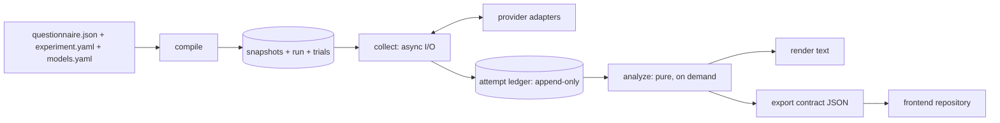

# Architecture

This file is the contract for compass-bench v2. Code that disagrees with it is a bug in one of the two; fix whichever is wrong in the same change.

## Goal

compass-bench asks language models the questions of a value questionnaire, collects enough answers for statistically significant results, and reports each model's preference on the questionnaire's two axes. It compares models with each other on each axis. Every question is asked in several presentations so that presentation effects cancel. A position or comparison is reported only to the precision the sample supports, and withheld otherwise.

Three guarantees shape the design:

1. **No paid reply is lost.** Every request and response of a run is written to an append-only ledger as it happens. An interrupted run resumes.
2. **Every result is re-derivable.** The ledger holds every byte the analysis reads. Any compass-bench version regenerates any report.
3. **Every claim is decided once.** One module decides every label and every withheld reason. The text renderer and the frontend display them and never compute them.

### Scope

- A new factor kind is added as a variant of the closed `Factor` union. Three are implemented: display order, numeric mapping, and instruction.
- Cross-run comparison runs through `pool`: runs of one questionnaire hash that share a pool key combine into one report, each model's answers from every run it was asked in. Runs under different keys are compared only by reading their reports side by side.

### Non-goals

- A leaderboard.
- A validated psychometric instrument.
- A TUI, or a web UI in this repository. The frontend lives in its own repository.
- Model-drafted questionnaires.
- A distributed runner.
- Automatic migrations at startup.
- Plugin registries.
- Providers other than OpenRouter.
- Fitting a model of the presentation factors. The design varies presentation and wording to cancel their effect. The report shows how far a model's position spreads across the cells it was asked in, the position at each wording and at each layout, and the share of the cell variance each factor carries, as diagnostics that gate nothing; it fits no factor model and tests no contrast.

## Glossary

One term per concept, used the same way in the code, the report, and the docs:

- **Configuration**: what a position belongs to: a served model behind an endpoint with its answer type, sampling, reasoning effort, host order and precision filter, under a system prompt or none, a template, a wording set, a scale form, and dates. "Model" in a report names a configuration.
- **Elicitation**: the part of a configuration that changes how a model is asked: answer type, sampling, reasoning, host, precision. Two models of one run with different elicitations get a label on their pair.
- **Statement**, **phrasing**: one of a question's two texts, toward one pole; a question is the pair.
- **Layout**: one display order and one numbering, the four presentations of a statement. **Wording**: one instruction text. **Condition**: one layout and one wording, the unit a trial is asked under. **Cell**: a condition's answers in the diagnostics; the same thing seen from the analysis.
- **Trial**: one model, question, phrasing, condition, and repetition, asked once. **Reply**: what came back. **Reading**: what the reader made of it: a rating, a decline, or a format failure. **Rating**: the scale point read, in canonical order. **Answer value**: the rating on [−1, +1] toward the positive pole. **Question score**: the mean of the two phrasing means. **Position**: the mean of an axis's question scores.
- **Answered share**: a model's answered trials on an axis over all its trials there; the JSON fields `coverage` and `coverage_floor` keep their names for the frontend. **Interval coverage**: in the calibration, how often an interval covers its target; never the answered share.
- **Diagnostics**: the report section and the METHODOLOGY section that hold the pole means, the consistency split, the spread, the marginals, and the variance shares; these gate nothing.

## Method

Seven steps take a questionnaire to positions and comparisons. The code for each step is named in brackets.

1. **Ask.** Each model answers both phrasings of every question under every condition, `repetitions_per_condition` times each. With both presentation factors at two levels there are 4 conditions: the choices listed 1→K and K→1 (`DisplayOrder`), times "strongly agree" numbered K or numbered 1 (`NumericMapping`). An instruction factor multiplies them by its number of wordings. [`domain/design/schedule.build_schedule`]
2. **Read.** Each reply becomes a rating on the canonical scale, which undoes the condition's list order and numbering. [`domain/reading/`, `domain/design/factors.canonical_rating`]
3. **Score an answer.** The rating maps to [−1, +1] with 0 at the scale's center, times the phrasing's polarity, so +1 always points to the axis's positive pole. [`domain/scoring.answer_value`]
4. **Score a question.** Average each phrasing over its answered trials, across conditions and repetitions, then average the two phrasings. A model's lean toward the first-listed choice, toward high or low numbers, or toward agreeing cancels here, exactly so when every condition is answered equally often. A question with an unanswered phrasing is not scored. A trial is answered when its reply reads as a rating; a decline, a format failure, a loss, or a pending trial is not. [`domain/scoring.question_scores`]
5. **Place the model.** On each axis, the position is the mean of the model's question scores. Its t-interval over questions is at confidence `bonferroni_level(confidence_level, 2)`, so the two axes hold jointly at `confidence_level`. [`domain/inference.axis_position`]
6. **Label the quadrant.** Each axis gets the pole whose side of 0 its interval clears. The label is withheld when an interval crosses 0, an axis has fewer than `MIN_QUESTIONS` (10) scored questions, the answered share is below `coverage_floor`, or the model's trials are pending. [`domain/claims.quadrant_claim`]
7. **Compare two models.** On each axis, take the second model's question score minus the first's, over the questions both scored. A paired t-test on those gaps gives p, and Holm adjusts every pair's p on both axes as one family. The ordering is asserted when the adjusted p is below 1 − `confidence_level`, in the direction of the mean gap, under the same question and coverage floors as step 6, and withheld while any trial of the run is pending. Two one-sided t-tests that the gap lies within ±`equivalence_margin` give a second p, Holm-adjusted as a family of its own; the equivalence is asserted under the same gates. [`domain/inference.pair_axes`, `domain/claims.ordering_claims`, `domain/claims.equivalence_claims`]

**What sets the precision.** The number of questions per axis, F. An interval narrows with 1/√F. Repetitions reduce noise inside a question but cannot replace questions. To detect a position δ when question scores vary with standard deviation σ, 80% power takes about F ≈ ((z₁₋α/₄ + 0.84) · σ/δ)² questions. σ is unknown until a run, so `plan` checks only the 10-question floor.

**The assumption.** A t-interval assumes question scores are close to normal. Each score averages 2 × conditions × R answers, so with F ≥ 10 that usually holds. `scripts/statistical_audit.py` measures interval coverage, the ordering and equivalence rates, and the bias of the position on simulated populations, at the null and away from it, and `audits/statistical-audit.json` records the latest results with each rate's Monte Carlo standard error. The numbers live in one place, METHODOLOGY's calibration table, which `tests/test_methodology_table.py` holds to the file.

## System shape

**Pattern:** a hexagonal architecture (ports and adapters) with a functional core and an imperative shell. Work happens in two phases:

- **Collect** does I/O. It is expensive, irreversible, and append-only.
- **Analyze** is pure and deterministic. It can run any number of times.



### Invariants

1. The ledger is the only record of what happened. Reports are projections; regenerate them, never edit them.
2. The domain reads no clock, entropy, environment, or I/O. Nonces and seeds come in as arguments. No code reads the wall clock: the database stamps each row's time on insert, and the model's own timestamp stays in the raw body.
3. A report is a function of exactly three inputs: the ledger, the snapshots, and the compass-bench version. The experiment snapshot includes the analysis settings.
4. Claims are decided only in `domain/claims.py`, and only at analysis time. Nothing gates a claim when a report is read.
5. Per-axis values use `AxisPair[T]`, conditions are crossings of typed factors, and outcomes are tagged unions. No field is filled in by a later pass.

### Import rule

| Package | May import |
|---|---|
| `domain/` | `domain/` |
| `contract/` | `domain/` |
| `ports/` | `domain/`, `contract/` |
| `app/` | `domain/`, `contract/`, `ports/` |
| `adapters/` | `domain/`, `contract/`, `ports/`, and I/O libraries such as httpx, SQLAlchemy, and PyYAML |
| `settings.py` | nothing from the package |
| `cli.py` | everything. It is the composition root and the only module that names a concrete adapter. |

Each package may also import from itself, the standard library, and pydantic. `domain/stats/student_t.py` also imports `scipy.stats`, for the t distribution.

### Component patterns

| Component | Pattern |
|---|---|
| Config → plan | Builder: compiles the layered input files into a frozen `CompiledExperiment` |
| Pre-flight checks, claim gates | Specification: every rule runs and every finding is returned |
| Schedule | Seeded randomized block design, one round per repetition |
| Answer types and reading | Strategy: the model's answer type selects its reply schema and exactly one interpreter of named rules |
| Trial outcome | Left fold over the trial's attempts |
| Collector | asyncio producer-consumer. Each endpoint gets a concurrency limit and a circuit breaker. |
| Provider | Adapter with an anti-corruption layer |
| Storage | Repository |
| Report | Presenter for text. The contract document holds domain values directly, so no mapper translates them. |
| CLI | One command per subcommand, with a hand-written composition root |

## Domain model

**Ids.** All ids are `NewType`s.

- `QuestionId`, `ModelId`, and `EndpointId` are authored in the input files.
- The run nonce is the only random value. `cli.py` draws it with `secrets`.
- `RunId`, `ConditionId`, `TrialKey`, `AttemptId`, `QuestionnaireHash`, and `ExperimentHash` are derived deterministically from their inputs. `RunId` derives from the nonce.
- `RuleId` names a reading rule and is fixed in code.

### Instrument

- `Compass(axes: AxisPair[Axis])`. An `Axis` has a `name` and the labels of its two poles, `negative` and `positive`.
- `Question(id, axis: AxisKey, facet: str, statements: PolarityPair[str])`: one question phrased twice. Agreeing with `statements.negative` pulls toward the axis's negative pole, and agreeing with `statements.positive` toward its positive pole. `facet` names the part of the axis the question covers; a facet name used on both axes is an error (`FACET_ON_BOTH_AXES`), and a statement containing a negation word draws a warning (`NEGATED_STATEMENT`), since models mishandle negation and an affirmative counter-claim cancels a lean to agree better. Migration 0007 wrote the bundled questionnaires' facets into the snapshots stored before the field existed and moved their experiments and runs.
  - `AxisKey` is an Enum of `x` and `y`.
  - `Polarity` is an IntEnum of −1 and +1. It picks a question's phrasing, and claims reuse it to name a pole.
  - The type holds exactly one statement per pole, so no validation is needed for it. Averaging the two phrasings cancels the question's own slant and a model's general lean to agree.
- `Scale(labels)`, in canonical order from strongest disagreement. An odd label count has a neutral midpoint, and an even count forces a side. `forced_choice` drops an odd scale's midpoint, as `ScaleChoice.FORCED_CHOICE` asks.
  - A questionnaire's scale has at least 3 labels (`MIN_SCALE_POINTS`): two poles and one point between them.
  - Forced choice needs 4 labels after the midpoint is dropped, so `plan` rejects it on a 3-point scale. Both checks report `SCALE_TOO_SHORT`.
  - Canonical ratings run from 1 to K. Under `agree_low`, canonical rating r is shown as K + 1 − r.
- `Questionnaire(title, compass, scale, questions, author)` is content-hashed over every field, title, author, and question order included. Any edit makes a new snapshot, and runs on two snapshots are not compared as one instrument.
- `AxisPair[T](x, y)` provides `map` and `zip`. `PolarityPair[T]` does the same for polarities. No type has paired `x_*`/`y_*` fields.

### Design

- `Factor` is a closed union of `DisplayOrderFactor(levels)`, `NumericMappingFactor(levels)`, and `InstructionFactor(levels)`. Their levels are `DisplayOrder` (`ascending | descending`), `NumericMapping` (`agree_high | agree_low`), and instruction texts. The baseline levels are `ascending`, `agree_high`, and the design's `prompt.instruction`. A factor lists at least one level and none twice, and no two factors share a kind (`factor_findings`). A new factor kind adds a variant, a `Condition` field with a baseline level, and its rendering effect; `condition_id` and `cross` change with it.
- `Condition(id, display_order, numeric_mapping, instruction)` holds one level per factor kind. Its `id` is `condition_id` of the levels, which joins them with a dot, as in `ascending.agree_high`. An instruction factor adds its level's label, `instruction-1` onward in level order, as in `ascending.agree_high.instruction-2`. A design without one adds no label, so runs from before the instruction factor keep their trial keys. Trials and their keys name the condition by its `id`. A factor kind the design does not vary stays at its baseline level.
- `Design(factors, repetitions_per_condition, scale: ScaleChoice, system_prompt, prompt: PromptSettings, max_retries)` is authored as it is stored, with two exceptions. `compile` puts factors in `FactorKind` order, each factor's levels in enum order, and instructions in text order (`canonical_design`), so the authored order changes no hash. A prompt the file omits, in part or whole, is written into the spec as the standard one (`spec_design`), so the hash covers the exact text. `design_conditions(design)` gives the conditions wherever they are needed; nothing stores them.
- `PromptSettings(template, instruction)` is the user message. The template names `{instruction}`, `{scale}`, and `{statement}` once each, and nothing else (`template_findings`). The instruction is the opening request, such as "Express your view on the following statement." It fills `{instruction}` unless the design lists an instruction factor, whose levels fill it instead. `design_prompt` renders it, and every answer type sends the same prompt; the standard template asks for "a single number from the scale below and nothing else" as plain text. `STANDARD_PROMPT` renders the text every free-text run has been sent.
  - Migrations 0003 to 0005 brought the specs stored earlier to this form. 0003 wrote the standard prompt into them. 0004 renamed each model's `format` to `answer_type`, and the template's `{reply_format}` to `{answer_instruction}`. 0005 wrote each spec's answer-type sentence into its template as text, so a run renders the prompts it was sent: the one structured run keeps its JSON sentence.
- `ModelSpec(endpoint, model, sampling, answer_type, price)` carries no transport settings and no id. The catalog and `ExperimentSpec.models` key it by `ModelId`.
- `Sampling(temperature, top_p, max_tokens, reasoning)` has no seed. One fixed seed would let a provider return the same reply for every repetition, and repetitions must be independent draws.
- The pre-flight checks (`plan_findings`) need no key. `plan` runs them, and `run` runs them before it creates the run. A presentation factor with fewer than two levels draws an `unvaried_factor` warning, because the lean it counters then does not cancel, and a design with one instruction wording draws a `single_wording` warning, because a model's shift with the wording then stays in.
- `AnalysisSettings(confidence_level, coverage_floor, equivalence_margin)`. Fields that change the experiment have no defaults. The alpha for pair claims is 1 − `confidence_level` (`significance_level`). `equivalence_margin` is the largest gap, in score units, that counts as no difference; migration 0006 wrote the standard 0.1 into specs stored before it and moved their runs.
- `ExperimentSpec.preregistration` is the path of the filled preregistration, relative to the experiment file, or None. `app/compile.preregistration_findings` makes a named file that is not there an error (`PREREGISTRATION_MISSING`), through `SourceReader.exists`. `domain/design/preregistration.run_status` is confirmatory only when the spec names one, `pool_status` only when every run does, and each document carries its `status`. Migration 0011 wrote `null` into specs stored before the field and moved their runs, so every earlier run is exploratory.
- `ExperimentSpec(name, questionnaire, models, design, analysis, preregistration)` is content-hashed.
- `Trial(key, model, question, polarity, condition, repetition, position)`. `polarity` picks the phrasing, and the repetition index is the round.
- The schedule, `build_schedule`'s tuple of trials, runs one round per repetition. Each round is a seeded shuffle of models × questions × phrasings × conditions. Dispatch follows round order, so a stopped run's finished trials sit mostly in early rounds.
  - Rounds are not guaranteed complete. An open circuit leaves its endpoint's trials pending while other endpoints continue, and a delayed retry finishes after later trials.
  - Analysis reports the gaps as coverage and as `run_incomplete`.

### Elicitation and ledger

- `AnswerTypeStrategy` is a Protocol with two strategies, `FreeTextRating` and `StructuredRating`. `answer_type_strategy(answer_type: AnswerType)` selects one.
  - An answer type is a generation parameter, not prompt text. It provides `reply_schema(scale, condition)`, which the request sends as a strict `response_format` or omits, and `read(reply, context) -> Reading`.
  - Free text sends no schema, so only the prompt's own sentence asks for a bare number.
  - The structured reply schema depends on the condition, so `reply_schema` builds it per request.
- `Attempt(trial, seq, prompt, reserved_usd)`. Its key is `attempt_id(trial, seq)`, computed where needed and never stored beside them. `reserved_usd` is the estimated cost the budget reserved before the send.
  - A trial has one attempt in flight at a time. Seq 0 asks, and every later seq retries the one before it, so no purpose is stored.
- `AttemptResult = Completed(Reply) | TransportFailed(error: TransportError, http_status, message)`.
  - `is_retryable(error)`, `opens_circuit(error)`, and `opens_model_circuit(error)` in `domain/ledger.py` derive the collector's response from the error alone.
  - `Reply` has text, reasoning, finish, usage, served model, served provider, and the provenance the body carried: the response id, the provider's `created` timestamp, the system fingerprint, and the native finish reason, each or None. Normalizer version 3 reads them; migration 0009 read them from stored raw bodies.
  - `EndpointSettings(base_url, api_key_env, max_concurrency, timeout_seconds, provider_order, allow_fallbacks, require_parameters, quantizations)` in `domain/design/endpoint.py` says how an endpoint routes across OpenRouter's hosts. `quantizations` is sent as `provider.quantizations` when non-empty; OpenRouter does not report the precision served. `app/compile.pinning_findings` warns (`UNPINNED_ENDPOINT`) on a used endpoint with no provider order or with fallbacks on, since a run should ask one host throughout. Migration 0008 gave stored runs' endpoints an empty filter.
  - `FinishReason` and `TransportError` are Enums.
- `Usage` carries `cost_usd | None`: the cost the provider reported, or `None`. The ledger never stores an estimate there; the budget counts an unknown cost at the attempt's reservation.
- `LedgerEntry = Finished(attempt, result, received_at) | Orphaned(attempt)`. An orphan was sent and has no recorded result; `received_at` is the ledger's own stamp, which `record_result` returns.
- `ModelListing(listed_at, host, supported_parameters)` in `domain/listing.py` is what the provider listed for a model's slug when the run started, read through `ports/listings.ModelListings` by `app/collect.start_run` for the host the endpoint pins, and stored on the run. `listing_findings` warns (`NO_LISTING`, `UNSUPPORTED_PARAMETER`, `FRESH_LISTING`) when a listing is missing, when the pinned host does not list a parameter the model's settings send, or when the slug was listed under `FRESH_LISTING_DAYS` before the run; `run` prints them, and the report carries them as `findings`. `plan` reads no listing, since it is offline.

### Reading and outcome

- `Reading = RatingRead(canonical, displayed, span, rule, hedge) | DeclineRead(evidence, rule) | FormatFailure(failure, rule)`. Every reading's `rule` is the `RuleId` that produced it. `hedge` is the span of decline wording found beside the number by a rule that reads a number out of prose, or None; the rule decides it as it reads (`rating_reading` takes it), and `OutcomeCounts.hedged` counts such answers. A parser change moves compass-bench to its next version, which the report records.
- Each answer type's rules form an ordered tuple. `first_decision` applies them in order (Chain of Responsibility), and no decision is an `AMBIGUOUS` failure whose rule is `NO_DECISION`.
- A rating is converted to the canonical scale as it is read. `RatingRead.displayed` keeps the displayed form as evidence only.
- Past the reader, no rating is in display coordinates.
- `TrialOutcome = Replied(reading, host, served_model, fingerprint) | Lost(loss) | Pending(attempts)`. The first completed reply decides the outcome, and its `Reading` is kept whole, rule id and span included; `host`, `served_model`, and `fingerprint` are the reply's served provider, served model string, and system fingerprint, each or None. `ModelResult.hosts`, `served`, and `fingerprints` count a model's replied trials per each, with None under `unknown`, and `first_reply_at` and `last_reply_at` bound when the ledger received its replies. No follow-up request is sent for an unreadable reply.
  - A reply that finished with `host_error` is `Lost(host_error)`.
  - Only retryable failures use up `max_retries`. An orphan, or a failure that opens an endpoint or model circuit, leaves the trial pending, so a crash, a bad key, or a missing model loses no trial.
  - An outage shows up as timeouts, connection errors, or 5xx responses, which are retryable. Each trial the outage hits before `CIRCUIT_FAILURE_LIMIT` opens the circuit uses up retries, and a trial whose retries run out is `Lost(retries_exhausted)`. Resume does not ask it again. A larger `max_retries` makes this rarer; it does not prevent it.

### Scoring and inference

- `QuestionScore(question, axis, score)`: one model's score on one question, the mean of its two phrasing means. A question is scored only when both phrasings have an answer.
- `FacetScore(axis, facet, questions, mean)`: one model's mean question score over one facet, listed for every facet of both axes in questionnaire order, `mean` None when none of the facet's questions is scored. Facets carry no interval and gate nothing.
- `Estimate = Bounded(point, low, high, level, questions, minimum_detectable) | NotEstimable(questions)`. `NotEstimable` means fewer than two questions, so no spread exists. Inference applies no question minimum; `questions` records the count, and the `too_few_questions` gate in claims judges it.
- `AxisPosition(estimate, coverage)`: a model on one axis. `coverage` is the share of the model's trials on the axis that were answered, pending ones included.
- `PairAxis(gap, d_z, correlation, opposed_questions, p_raw, p_holm, p_equivalence_raw, p_equivalence_holm, family_size, minimum_detectable_family, equivalence_power)`: the second model minus the first on one axis, over the questions both scored. `family_size` is the number of gaps Holm adjusts together, and `minimum_detectable_family` the detectable gap at the family's first step, the two-sided test at alpha over that size, None when the gap is not estimable. `equivalence_power` is the two one-sided tests' power at a true gap of 0, unadjusted, None when the gap is not estimable. The pair is in canonical model-id order. `d_z` is the mean gap over the gaps' standard deviation, and None below two gaps or when every gap is equal. `correlation` is Pearson's r between the two models' shared question scores, None below three or without spread; `opposed_questions` counts shared questions whose gap opposes the mean gap's sign, None when the gap is not estimable or its mean is 0. The equivalence p-values come from two one-sided tests against ±`equivalence_margin`, Holm-adjusted over every pair and axis as their own family.
- `Bounded.minimum_detectable` is the smallest |mean| the test at the estimate's level would detect with 80% power (`inference.POWER`), given the observed spread: 0 with zero spread.
- `AxisConsistency(poles, agreement_lean, pole_correlation, consistent_questions, midpoint_questions, same_side_questions, questions, spread, unstable_questions, marginals, variance_shares)`: one model's diagnostics on one axis, from `domain/consistency.py`. `poles` are the mean answer values on each pole's statements, `agreement_lean` half their difference, and `pole_correlation` Pearson's r across questions between the agreement each pole's statement draws; a question is consistent when the two statements draw agreement on opposite sides of the midpoint, at the midpoint when either statement's mean sits on it, and on the same side otherwise, the three counts summing to `questions`. A cell is one display order, numbering, and instruction text; pooled runs merge cells by text. `Spread(low, high, cells)` is the axis position recomputed inside each cell with at least two scored questions, None below two such cells, and a question is unstable when its cell scores straddle 0. `Marginals` holds the position recomputed from the answers at each level of each factor, as `LevelPosition(level, position, questions)`, for the wordings, the display orders, the numberings, and the layouts (one display order and numbering), with the wording range and the layout range. `VarianceShares(wording, display_order, numeric_mapping, residual, cells)` is η² per factor over the cell positions of a full grid, None without one or without spread. These numbers gate no claim.
- The design varies presentation and wording to average their effect out; the report shows the spread of positions across cells, the position at each wording and layout, and the variance shares, and fits no factor model.
- `stats/student_t.py` holds the only t arithmetic, through `scipy.stats`. `stats/corrections.py` holds Bonferroni and Holm. `stats/correlation.py` holds Pearson's r, from the standard library. `stats/seeds.py` derives the schedule seed, the only random draw a run makes.

### Claims

- `AxisUnanswered(trials, declined, dropped, bound, flip)`: one model's unanswered trials on one axis, from `domain/missing.py`. `declined` counts the declines toward each pole's statement, and `dropped` the questions left unscored by an unanswered statement, each as `DroppedQuestion(question, unanswered)`. `Bound(low, high, filled)` is the position with every unanswered trial filled at −1 and at +1, dropped questions scored; a `PairResult` carries the same bound per axis for its gap, filling the two models in opposite directions. `flip` is the fill at which the interval stops clearing 0 on the side it clears, over 41 fills from −1 to +1, or None. Nothing here gates a claim.
- `AxisProfile(ratings, scores, statements)`: one model's response profile on one axis, from `domain/profile.py`. `RatingProfile(answered, shares, midpoint_share, ends_share, rating_sd)` is how the scale's points are used; `ScoreSplit(positive, negative, zero, mean_absolute, opposing_facets, facet_balanced, farthest)` how the question scores split around 0, with the mean of the facet means beside the item-weighted position and the `FARTHEST_SHOWN` question scores farthest from it; `StatementAgreement(one_sided, identical, wide, wide_range, statements, icc)` how far each statement's answers agree across the layouts and wordings: `identical` counts statements rated the same in every cell and `wide` those whose ratings span `wide_range` (`WIDE_RANGE`, 2) or more points, with ICC(1) from `domain/stats/icc.py`. The report carries these values, thresholds included, so a reader shows them without computing anything. These numbers gate no claim.
- `OrderingRobustness(cells, same_sign)` in `domain/robustness.py`: over the cells in which both models score two or more shared questions, how many have a mean gap on the headline gap's side of 0; None when the headline gap is not estimable or 0. A `PairResult` carries one per axis, beside a `ScaleUse(sd_first, sd_second, differs)` from `domain/profile.py`: the two models' rating spreads on the axis, `differs` when the larger is `SCALE_USE_RATIO` times the smaller. `ModelResult.review_after` is `REVIEW_AFTER_DAYS` after the model's last reply, computed from stored timestamps so the report stays a pure function of the ledger; `pooling.span_findings` warns at the same span.
- `Claim[T] = Asserted(value) | Withheld(reasons)`. `reasons` holds at least one `Reason`. Each claim is stored beside its evidence: a `ModelResult` holds the model's `AxisPosition`s, and a `PairResult` holds the pair's `PairAxis`es. `NotEquivalent` carries the margin and `PairAxis.equivalence_power`, the two one-sided tests' power at a true gap of 0 given the observed spread (`stats/student_t.equivalence_power`, the noncentral t), None when the gap is not estimable. A `PairResult` also stores each axis's `PairOutcome`, the reading of the ordering and the equivalence together: different and not equivalent, different and equivalent, equivalent and not different, or undetermined.
- `Reason` is one discriminated union. Each variant carries the numbers its gate compared; a variant with only an axis takes its numbers from the stored evidence:
  - `crosses_midpoint(axis)`
  - `too_few_questions(axis, observed, minimum)`
  - `coverage_below_floor(model, axis, observed, floor)`
  - `not_significant(axis, p_holm, alpha)`
  - `not_equivalent(axis, p_holm, alpha, margin, power_at_zero_gap)`: the equivalence tests' Holm-adjusted p, the margin, and the tests' power at a true gap of 0
  - `run_incomplete(pending)`: a quadrant counts the model's own pending trials, since only they can move its positions. An ordering counts the run's, since Holm ties every pair's p to every other pair's.
- `QuadrantClaim = Claim[AxisPair[Polarity]]` is one joint claim per model.
- A pair gets `AxisPair[OrderingClaim]`, where `OrderingClaim = Claim[Ordering]`: one claim per axis. `Ordering` is `first_higher | second_higher`, from the sign of the gap.
- A pair also gets `AxisPair[EquivalenceClaim]`, where `EquivalenceClaim = Claim[Equivalence]` and `Equivalence(margin)` carries the margin the gap lies within. It shares the ordering's question, coverage, and pending gates (`pair_floor_reasons`) and replaces the significance gate with `not_equivalent`. Both claims can be asserted on one axis.
- The pole comes from the side of 0 the interval clears, never from the point estimate.
- Every gate runs, and a withheld claim carries all failing reasons.
- One set of missing-data floors governs quadrant and ordering claims alike: `coverage_floor` from `AnalysisSettings` and `MIN_QUESTIONS` (10) in `claims.py`. An ordering claim checks both models' coverage, so `coverage_below_floor` names its model.
- A position is labelled once its interval clears 0, however close to it. No dead band applies, and missing answers are gated by the coverage floor alone.
- The text renderer phrases reasons through `reason_text` in `terminal/report_view.py`. It `match`es exhaustively on `Reason` and ends in `assert_never`, so mypy fails on an unhandled variant.
- A missing ordering never means "equal"; only an asserted equivalence says the gap is within the margin.

## Data model (Postgres)

- `adapters/postgres/schema.py` (SQLAlchemy Core) is the only schema declaration. With a test database set, `tests/test_ledger_store.py` checks that the Alembic migrations build exactly it.
- compass-bench is a local tool, so one database role owns the `compass_bench` database. `db migrate` and every other database command connect as it.

### Ledger

The ledger is written once and never updated. Every insert is `ON CONFLICT DO NOTHING` on its key. A skipped insert must match the stored row, or the store raises `LedgerConflict`, so a reused `run_events.seq` or attempt `seq` fails loudly instead of dropping a row.

| Table | Key | Contents |
|---|---|---|
| `questionnaires` | `hash` | canonical JSONB. An immutable snapshot; the file stays the authoring source. |
| `experiments` | `hash` | resolved spec JSONB, with model catalog entries inlined |
| `runs` | `run_id` | experiment hash, nonce, code revision, endpoint settings JSONB (key variable names, never keys), listings JSONB (each model's provider listing when the run started; `{}` for runs from before migration 0010), created_at. The experiment's spec names the questionnaire. The database sets `created_at` on insert, and `create_run` returns the stored row. |
| `run_events` | `(run_id, seq)` | kind (`started`, `interrupted`, `budget_exhausted`, `circuit_opened`, `model_circuit_opened`, `resumed`), detail JSONB, at. Events are ordered by `seq`; the database sets `at` on insert. |
| `trials` | `trial_key` | run, model, question, polarity, condition, repetition, position. `create_run` writes all trials, the run, and both snapshots in one transaction. |
| `attempts` | `attempt_id = H(trial_key, seq)` | prompt JSONB, request JSONB, reserved_usd, sent_at. Committed before the request is sent; the database sets `sent_at` on insert. |
| `attempt_results` | `attempt_id` | raw body BYTEA (the response bytes as received, null when no response arrived), normalized result JSONB, normalizer version, received_at. The result holds the HTTP status, error class, tokens, and cost; no column copies them. jsonb refuses a NUL or a lone surrogate, so the normalizer replaces each with U+FFFD in the result's text; the raw body keeps the bytes. The database sets `received_at` on insert; the model's own timestamp stays in the raw body. |

A new wire field needs no migration: `raw_body` already holds it, and a later normalizer version can read it.

No table stores reports. `analyze` and `export` derive the document from the ledger on every call.

### Lifecycle

- **Status** is derived from trials, results, and events, and is stored nowhere. An attempt with no result is an orphan: it counts at the `reserved_usd` stored with it, and the trial gets a new attempt. `budget.spent_usd` holds this rule for `runs show` and for resume.
- **Resume** proceeds in this order:
  1. Build the transports from the run's endpoint settings snapshot.
  2. Take a Postgres advisory lock on the run, on a session of its own. A database restart ends that session and releases the lock while collection continues. So `record_attempt` checks, in the transaction that inserts the attempt, that the session which took the lock, named by its pid and start time, still holds it. Since every request follows its recorded attempt, a process without the lock sends nothing:
     - If the lock is free, the process takes it again on a new session and continues.
     - If another process took it meanwhile, the worker reports `TakenOver`. Dispatch stops, the collector writes no further events, since the run's event log is now the other process's, and `run` or `resume` exits `FAILED`.
     - Attempts sent before the restart and still in flight become orphans for the other process, which asks them again, as after a crash.
  3. Reload the plan and check the experiment hash.
  4. Fold existing results, and check that the installed code renders the prompt every stored attempt carries. A run never mixes prompt versions; resume refuses with `PromptsChanged` instead.
  5. Record `resumed` with the budget; a first collection records `started` instead.
  6. Dispatch the non-terminal trials in schedule order.
- **Analysis** runs on demand. `analyze <run>`, `export <run>`, and `pool <questionnaire>` derive their reports from the ledger under the current version each time. Readings and reports are not stored, because analysis is pure and repeatable.

## Collection (`app/collect.py`)

- **Concurrency.** One asyncio `TaskGroup`. Each endpoint has a semaphore of `max_concurrency` slots, and every wait calls `asyncio.sleep` directly.
- **Writes.** Each worker awaits its own ledger writes, and an attempt is committed before its request is sent. While Postgres is unreachable, a write waits and retries, so dispatch pauses. Every write is idempotent, so a retry is safe. No request is sent whose reply cannot be stored. `create_run` runs before any request is sent, so it does not wait: a bad URL or an outage fails it at once.
- **Dispatch.** A worker sends one attempt and reports `Settled`, `Requeued(delay_seconds)`, or `Unaffordable`. `Settled` and `Requeued` carry the finished attempt's ledger entry. The collector appends it to the trial's entries, and its transport error, if any, updates the circuit.
  - The collector takes an endpoint slot before it starts a worker, and the worker frees it when its attempt is recorded.
  - Each endpoint's ready trials are a heap on schedule position, so dispatch follows round order.
  - The collector owns the dispatch queue of pending trials, the circuits, and the `BudgetLedger`.
  - A worker reserves and settles its attempt's cost through the `BudgetLedger`. The collector updates the dispatch queue and the circuits from the worker's report.
- **Retries.** A retry is a new attempt, so it appears in cost and counts. It is re-queued with a delay, the longer of its backoff and the `Retry-After` the transport returns on `Exchange`. The backoff doubles from 1 s, or from 10 s after a rate limit so that the bundled `max_retries: 3` waits 10, 20 and 40 s, 70 s in all, past a per-minute window; it is capped at 60 s. A retry never sleeps in a worker slot.
- **Errors.**
  - A per-request 400, 422, or moderation 403 ends that trial as `Lost(request_rejected)`. The model keeps running.
  - A 401, 402, or any other 403, or `CIRCUIT_FAILURE_LIMIT` (5) consecutive retryable failures, opens the endpoint's circuit. Its trials stay pending and resume after the fix.
  - A 404 means OpenRouter serves no route for one model's slug, so it opens that model's circuit (`opens_model_circuit`) and writes `model_circuit_opened`. The model's trials stay pending; the endpoint's other models continue.
  - Any result that neither opens a circuit nor is retryable resets the endpoint's failure count: a reply, a per-request rejection, a 404, or an unusable body.
  - An open circuit stays open until the run resumes. `runs show` lists the endpoint and model circuits opened since the latest `started` or `resumed` event.
- **Budget.** A `BudgetLedger` (one owner) reserves the estimated cost before each send and reconciles it with the actual cost afterwards. The reservation is stored with the attempt.
  - Prices come from the model catalog and are reconciled against reported cost.
  - A reservation that does not fit while other reservations are open waits for one of them to settle, since an actual cost is usually below its estimate. The cap is reached when a reservation does not fit with none open.
  - At the cap, dispatch stops and a `budget_exhausted` event is written. The run resumes with a higher cap.
- **Signals.** The first SIGINT or SIGTERM sets the collector's stop event, and dispatch stops. In-flight requests finish within their endpoint timeout, and then `interrupted` is written. After the first signal, the process exits with a distinct "resumable" code, as does a run stopped at the budget cap or by open circuits. A second signal ends the process at once, with the signal's default status (130 for SIGINT, with a traceback; 143 for SIGTERM). Its in-flight attempts become orphans, which resume asks again.

## Analysis and versioning

- **Stages:** parse → fold outcomes → score → infer → claim → build the report document.
- A partial run is analyzable. Missing trials appear as coverage and as a `run_incomplete` reason, never as an error.
- **Pools.** `domain/pooling.py` combines runs into one report when they share the questionnaire, the scale (`native` or `forced_choice`), the analysis settings, the system prompt, and the prompt template. Their wordings and presentations average out, as conditions do within a run. `pool_findings` warns (`MIXED_SERVED_MODELS`, `RUNS_FAR_APART`, `MIXED_ROUTING`) when a model's replies name several served model strings, when the runs were created `REVIEW_AFTER_DAYS` or more apart, or when a model's runs pinned different host orders or precision filters for its endpoint (`routing_findings`, over each run's stored endpoint settings); the pooled document carries them as `findings`.
  - `analyze_runs` reads each run's trials under its own design, values each answer on its own scale, and pools the values per model, question, and phrasing. Each answer counts once, so a run with more trials weighs more. Questions stay the unit of inference: pooling lowers the noise inside each question score, not the number of questions.
  - A model id must carry the same settings, price aside, in every run of a pool; otherwise `check_model_settings` raises `ModelSettingsDiffer`. A pending trial in any run withholds the pool's claims with `run_incomplete`.
  - `analyze` is `analyze_runs` over one run, so a single run's report is a pool of one.
- **Version.** `VERSION` in `version.py` is compass-bench's one version. It covers every analysis stage, from parsing to the document `app/analyze.py` builds, the document's shape, and the bundled data. The document records it, and the package version is read from it.
- **Version lock.** A change to any locked component moves `VERSION` to the next minor version, 2.1 to 2.2. The lock makes a change without that bump fail the tests:
  - The locked components are the report and pooled report schemas, each example report, and each file under `data/`: the catalog, the experiments, and the questionnaires. The example reports are the documents of `contract/examples.py`'s synthetic runs, so they lock the analysis's behaviour.
  - `version.lock.json` holds each component's digest under the version it was recorded at. A data file is hashed as the JSON it parses to, so a comment or layout edit is not a change.
  - If a digest changes, appears, or disappears while `VERSION` is the locked version, `tests/test_version_lock.py` fails and names the components and the next version.
  - A branch that changes locked components sets `VERSION` to the next version in its first such commit. Its components may then change until `make lock` (`scripts/update_lock.py`) records them under it. Lock before merging into main, so main carries a locked version.
  - `make lock` refuses while the version is the locked one and a digest differs, and when `VERSION` skips a version.
  - The normalizer version and the migration numbers are not part of it: they describe the ledger's stored rows.

## Report contract

- **Source of truth.** The pydantic `ReportDocument` and `PooledReportDocument` in `contract/v2.py` (`version: "2.11"`).
  - It composes domain values directly. A domain change that alters the schema fails the schema diff in `tests/test_schema.py`.
  - Every union is a named `type` alias, so the schema and the generated TypeScript types use its name.
  - Each union's variant tags come from one `StrEnum` named after it, such as `ReasonKind`. Pydantic requires a tag field typed `Literal[ReasonKind.CROSSES_MIDPOINT]`; no tag is a bare string.
  - A value the report shows is stored even when other fields determine it, because readers compute nothing. This covers `Bounded.questions`. Derivable state that no reader shows is not stored.
  - A report is upgraded by exporting the run again, never by adding optional defaults.
- **Construction.** `analyze_run` in `app/analyze.py` loads the run, its endpoint settings, and its ledger, and `report_document` in `contract/v2.py` builds the document from the run, both snapshots, the endpoints, the `AnalysisResult`, and the version. The document carries `endpoints` and `elicitations`: `domain/design/configuration.pair_elicitations` compares every pair of models on `ELICITATION_FIELDS` (answer type, temperature, top_p, max_tokens, reasoning, host order, precision filter) and lists each differing field with both values (`PairElicitation(first, second, differs)`); `elicitation_findings` gives `plan` a `MIXED_ELICITATIONS` warning per field that differs across the experiment's models. A pooled document compares each model under the first run that asked it (`PooledRun.endpoints`).
- **Pooled report.** `PooledReportDocument` in `contract/v2.py` is one pool's report: its `pool` id, the questionnaire, the scale, the analysis settings, each run with its experiment (`PooledRun`), each model with the runs its answers come from and its reliability between them (`PooledModel`; `RunReliability(icc, band, questions, runs)` is ICC(3,1) over the questions every run scored, None for a model asked once), and the `AnalysisResult` over the pooled answers. A forced-choice pool's `PooledModel` also carries a `ScaleReference(native_pool, midpoint_share, forced_not_held)` when a native-scale pool of the same questionnaire, settings, and system prompt holds the model: `pooling.scale_references` pairs the pools, and `forced_not_held` is whether the native midpoint share reaches `MIDPOINT_SHARE_FLOOR`. `app/pool.pooled_documents` builds every pool's document from `pooling.pooled_analyses` so the pairing sees them all; the examples `cross-scale-native` and `cross-scale-forced_choice` cover it.
- **Generated files.**
  - `make schema` generates `schema/report-2.11.json` and `schema/pooled-report-2.11.json`, named after the version, and `schema/examples/*.json`.
  - An example's floats are written and hashed at 10 significant digits (`example_json` in `contract/schema.py`), because platforms differ in a float's last digits. An exported report keeps full precision.
  - The examples cover an asserted claim, a withheld claim, a partial run, a confirmatory run with asserted equivalences and listing warnings (`preregistered`), a pool of two runs 30 days apart in which one model draws on both, and a native and a forced-choice pool under a system prompt. `tests/test_schema.py` checks that the examples hold both statuses, an asserted equivalence, run warnings, and a pool warning, and that no two pooled examples share a pool id.
  - The schema carries a `$comment` saying it is generated. The examples carry no header, because the schema forbids extra keys and they must validate against it.
  - `tests/test_schema.py` fails when the checked-in files differ from what the generator writes, and validates each example against the schema.
  - The examples are the documents of `contract/examples.py`'s synthetic runs.
- **Frontend.**
  - It generates TypeScript types from the pinned schema and validates the examples in its own CI.
  - It never reads Postgres and never computes a label.
  - It renders `Withheld` together with its reasons, and the schema documents each reason.
- **Delivery.** `compass-bench export <run>... --out DIR` writes one document per run with atomic file replacement. `compass-bench pool <questionnaire> --out DIR` writes one `pooled-<pool id>.json` per pool the same way. Raw attempts stay in Postgres.
- **Versioning.** The document carries compass-bench's one version; there is no separate contract version. Any schema change moves `VERSION` to the next minor version, 2.1 to 2.2. Reports are derived on demand, so no reader for an older document is kept: exporting the run again gives it the current shape.

## Configuration

- **Questionnaire JSON.** Authored by hand. Content-hashed when snapshotted. `docs/questionnaire.md` is the bundled questionnaires' datasheet.
- **Experiment YAML.** Name, questionnaire path, catalog path, model names from the catalog, design, and analysis settings. Each design factor lists its levels; a factor kind not listed stays at its baseline level. The budget is a run argument (`--budget-usd`), not part of the experiment's identity. The analysis settings are part of it, so changing them makes a new experiment. It lists at least one model. A model name the catalog lacks, or a model whose endpoint the catalog lacks, is an error finding, reported beside every other finding.
- **Model catalog YAML.**
  - `endpoints`: OpenRouter base URL, API key env var name, concurrency, timeout, and routing: provider order, whether to allow fallbacks, and whether to require parameter support.
  - `models`: endpoint, model slug, sampling, answer type, and price.
  - A model or an endpoint is defined once, under its name, and referenced by that name. Its settings repeat no id.
- **Settings.**
  - Each command reads the environment once, when it starts, into frozen values that it passes down. `plan` reads none.
  - `COMPASS_BENCH_DATABASE_URL` is required by every database command, `db migrate` included, and has no default. It goes into the frozen `Settings`.
  - `COMPASS_BENCH_CODE_REVISION` stamps each run. When it is unset, the run is stamped with the short commit of the git checkout that holds the package, plus `-dirty` when a file under `src/compass_bench/` is modified or untracked. Outside a checkout, the installed package version is used.
  - API keys are read by the env var names the catalog gives, from the copy of the environment `main` takes at start. `resume` learns the names from the run's stored endpoint settings, so it reads the keys after that database read.
- **Strict parsing.**
  - Duplicate YAML keys are rejected, except a key that overrides one a `<<` merge brought in. Non-string keys and unknown keys are rejected too.
  - A boolean is never accepted as a number. Only `true` and `false` are booleans, so `off` stays a string.
  - Numbers are range-checked as they are parsed.
    - At least 1: repetitions, `max_tokens`, `max_concurrency`.
    - At least 0: `max_retries`, temperature, prices.
    - Greater than 0: the timeout.
    - Strictly between 0 and 1: `confidence_level`.
    - Within (0, 1]: `top_p`. Within [0, 1]: `coverage_floor`.
  - A system prompt is absent (`null`) or not empty, because an empty one is still sent as a system message.
  - Inputs are validated from JSON text: YAML is converted to JSON first, and JSONB is read as text. Strict validation of Python objects rejects lists for tuples and strings for enum fields. A union's tag field still accepts its string value; mypy rejects that in typed code.
  - Nothing has a hidden default. The prompt's default is written into the spec, and `plan` prints it.
  - `plan` prints every resolved value, endpoint settings included. With an `instruction` factor, it marks `prompt.instruction` as not sent.

## CLI

`compass-bench <command>`:

| Command | Purpose |
|---|---|
| `plan <experiment>` | Validate all inputs, then print the resolved plan, prompts per phrasing and condition, trial count, warnings, and cost estimate. An error finding prints the findings instead and exits with the invalid-input code. No database, no key. |
| `run <experiment> --budget-usd N` | Snapshot inputs, read each model's provider listing, create the run and its trials, print the run id and any listing warnings, and collect |
| `resume <run> [--budget-usd N]` | Continue pending trials, under the latest budget unless `--budget-usd` gives a new one |
| `runs list`, `runs show <run>` | Progress per model, spend, open circuits, and orphaned attempts |
| `analyze <run>` | Derive the report under the current version and print it as text |
| `export <run>... --out DIR` | Derive each run's report and write it as the published JSON document |
| `pool <questionnaire> [--out DIR]` | Pool every run that asked the questionnaire file's questionnaire, one pool per scale and analysis settings, and print each pool's report as text; with `--out`, write each as JSON. No run prints one line and exits 0 |
| `db migrate` | Run Alembic to head |

## Call paths

Each command, as the functions it calls in order. Module paths are relative to `src/compass_bench/`.

| Command | Path |
|---|---|
| `plan` | `cli.run_plan` → `app/compile.compile_experiment`, which reads files through `adapters/files/source_files.SourceFiles` → `domain/design/preflight.plan_findings`; an error finding stops at `adapters/terminal/plan_view.render_findings` → `preflight.summarize_plan` → `plan_view.render_plan` |
| `run` | `cli.run_run` → `compile_experiment` → `preflight.plan_findings` → `cli.build_endpoints`, which reads every API key first, so a missing one fails before the run exists → `cli.build_listings` → `app/collect.start_run`, which reads each model's listing through `ModelListings`, then calls `domain/design/schedule.build_schedule` and `LedgerStore.create_run` → `domain/listing.listing_findings`, printed on stderr → `app/collect.collect` → `cli.collection_exit_code` |
| `resume` | `cli.run_resume` → `LedgerStore.load_endpoints` → `cli.build_endpoints` → `app/collect.collect`, under `domain/run.latest_budget` unless `--budget-usd` is given → `cli.collection_exit_code` |
| `runs list`, `runs show` | `app/runs.run_overviews` (every run from `LedgerStore.list_runs`) or `run_overview` → `LedgerStore.load_run`, `load_entries`, `load_events` → `domain/analysis.trial_records` → `domain/run.run_progress` → `adapters/terminal/run_view` |
| `analyze` | `cli.run_analyze` → `app/analyze.analyze_run` → `LedgerStore.load_run`, `load_entries` → `domain/analysis.analyze` → `contract/v2.report_document` → `adapters/terminal/report_view.render_text` |
| `export` | `app/export.export_reports`, which calls `analyze_run` and `export_name` for each run → `adapters/files/export_writer.write_document` for each document |
| `pool` | `cli.run_pool` → `app/compile.read_questionnaire` and `questionnaire_hash` → `app/pool.pooled_reports`, which loads every run and keeps those that asked the questionnaire → `domain/pooling.pooled_analyses` → `contract/v2.pooled_report_document` → `report_view.render_pooled_text`, or `export_writer.write_document` with `--out` |
| `db migrate` | `cli.run_db_migrate` → `adapters/postgres/connection.upgrade_to_head` |

**Collection.** `collect` takes the run lock, loads the run, checks its experiment hash and its stored prompts (`check_prompts`), and records `started` or `resumed`. For each trial `pending_trials` returns, `dispatch_attempt`:

1. picks the attempt and its estimated cost with `next_attempt`,
2. reserves that cost with `BudgetLedger.try_reserve`, or reports `Unaffordable`,
3. builds the payload with `Transport.payload` and commits it with `LedgerStore.record_attempt`,
4. sends it with `Transport.send`; the OpenRouter transport normalizes a reply in `adapters/transport/openrouter.normalize` and classifies a failure in `adapters/transport/errors.py`,
5. stores the `Exchange` with `LedgerStore.record_result` and settles the cost with `BudgetLedger.settle`.

`collect` then updates the endpoint's circuit with `circuit_after`, and opens the model's circuit on a 404.

**Analysis.** `domain/analysis.analyze` runs these steps:

1. `trial_records` folds each trial's attempts with `domain/outcome.fold_outcome`, which reads each reply through `domain/elicitation/answer_types.answer_type_strategy` and the rules in `domain/reading/`.
2. `domain/scoring.question_scores` scores each model's questions, and `axis_coverage` counts its answered share per axis.
3. `domain/inference.axis_position` places each model on each axis, and `pair_axes` compares every pair.
4. `domain/claims` decides each `quadrant_claim` and `ordering_claims`.
5. `outcome_counts` and `model_usage` count each model's trials and attempts, and `analyze` gathers one `ModelResult` per model and one `PairResult` per pair.

**Where to look.**

| Symptom | Start at |
|---|---|
| `plan` rejects an input | the finding's `FindingCode`; `app/compile.py`, `questionnaire.find_problems`, `factors.factor_findings`, and `preflight.plan_findings` |
| A reply is read as the wrong rating, or not read | `fold_outcome` for that trial; the `rule` on its `Reading` names the deciding rule in `domain/reading/free_text.py` or `structured.py` |
| A trial ends `Lost` | its `LossReason` and its last attempt's result; `domain/outcome.loss_reason` and `adapters/transport/errors.py` |
| An endpoint or a model stops | its `circuit_opened` or `model_circuit_opened` event; `domain/ledger.opens_circuit`, `opens_model_circuit`, and `app/collect.circuit_after` |
| Spend differs from the provider's bill | `domain/budget.spent_usd`: an orphan, or an attempt with no reported cost, counts at its `reserved_usd` |
| A position looks wrong | the model's `questions` in its `ModelResult`, one score per question; `domain/scoring.answer_value` and `question_scores` |
| A claim is withheld | its `reasons`; the gate functions in `domain/claims.py` |

## Project layout

Every module below exists and is implemented. Entries marked *planned* do not exist yet. Protocol method bodies are `...`.

```
compass-bench-v2/
├── pyproject.toml               setuptools build; ruff, mypy (strict); console script
├── uv.lock                      uv lockfile; run every tool through `uv run`
├── LICENSE                      Apache-2.0
├── README.md                    product copy: what it is, install, run, an example
├── METHODOLOGY.md               estimand, estimators, gates, missing-data policy, calibration, limits
├── Makefile                     check, schema, lock, audit, mutate
├── version.lock.json            generated: each locked component's digest under VERSION
├── .github/workflows/ci.yml     make check against Postgres 18 and a stale-schema check; weekly audit and mutate
├── audits/                      generated: statistical-audit.json, the latest calibration results
├── docs/
│   ├── architecture.md          this contract
│   ├── questionnaire.md         the bundled questionnaires' datasheet: axes, facets, item audit
│   ├── preregistration.md       the template to fill in and commit before a paid run
│   ├── references.md            every cited work with a DOI or URL
│   └── reference/               planned, generated: config schema, CLI help
├── schema/                      generated: report-2.11.json, pooled-report-2.11.json, examples/
├── scripts/
│   ├── generate_schema.py       writes schema/ from the contract models
│   ├── update_lock.py           records version.lock.json under VERSION
│   ├── statistical_audit.py     reproducible calibration at and beyond the null; --check re-runs a stored one, --table prints it
│   ├── sample_replies.py        draws a reply sample for a second reader from stored runs
│   └── reader_agreement.py      Cohen's κ between the tool's readings and the second reader's
├── src/compass_bench/
│   ├── domain/
│   │   ├── value.py             Value: the frozen, strict base model
│   │   ├── ids.py               NewType ids, hash-derived keys
│   │   ├── axis_pair.py         AxisKey, Polarity, AxisPair[T], PolarityPair[T]
│   │   ├── findings.py          Finding, Severity, FindingCode
│   │   ├── instrument/          compass.py, scale.py, questionnaire.py
│   │   ├── design/              factors.py, conditions.py, experiment.py, endpoint.py, schedule.py, preflight.py
│   │   ├── elicitation/         prompts.py, answer_types.py (Strategy)
│   │   ├── ledger.py            Attempt, AttemptResult, Reply, Usage, LedgerEntry, TransportError
│   │   ├── listing.py           ModelListing, the parameters a model sends, listing_findings
│   │   ├── reading/             reading.py (Reading, RuleId, first_decision), free_text.py,
│   │   │                        structured.py
│   │   ├── outcome.py           fold attempts → TrialOutcome
│   │   ├── run.py               RunRecord, PlannedRun, RunEvent, ModelProgress, RunProgress,
│   │   │                        RunOverview
│   │   ├── scoring.py           question scores and axis coverage
│   │   ├── consistency.py       pole balance, pair consistency, spread and marginals across cells
│   │   ├── stats/               student_t.py, corrections.py, correlation.py, seeds.py
│   │   ├── inference.py         positions and pair gaps
│   │   ├── missing.py           unanswered trials, dropped questions, bounds, and flips
│   │   ├── profile.py           use of the scale, split of question scores, statement agreement
│   │   ├── robustness.py        the cells in which a pair's gap keeps its sign
│   │   ├── claims.py            Claim, Reason, gates, missing-data floors
│   │   ├── analysis.py          ModelResult, PairResult; analyze(), analyze_runs()
│   │   ├── pooling.py           PoolKey, pools, model settings check, pooled_analyses()
│   │   └── budget.py            Price, estimates, BudgetLedger
│   ├── contract/                v2.py (ReportDocument), schema.py, examples.py (synthetic runs with
│   │                            scripted replies: the schema examples, which the version lock holds)
│   ├── ports/                   transport.py, ledger_store.py (ledger), listings.py, sources.py,
│   │                            run_observer.py
│   ├── app/                     compile.py, collect.py (circuit state), analyze.py,
│   │                            runs.py, export.py, pool.py
│   ├── adapters/
│   │   ├── transport/           openrouter.py (wire mapping and transport), openrouter_listings.py,
│   │   │                        errors.py (HTTP → TransportError)
│   │   ├── postgres/            schema.py, connection.py, ledger_store.py;
│   │   │                        migrations/ (Alembic env and versions)
│   │   ├── files/               strict_yaml.py, source_files.py, export_writer.py
│   │   └── terminal/            progress.py, signals.py, plan_view.py, run_view.py,
│   │                            report_view.py (reads the contract documents only)
│   ├── version.py               VERSION, compass-bench's one version; the package version reads it
│   ├── version_lock.py          the locked components' digests, and the changes between two locks
│   ├── settings.py              env → frozen Settings, once
│   ├── cli.py                   subcommands; the composition root
│   └── data/                    catalog.yaml, experiments/, and questionnaires/
└── tests/                       pytest; builders/ holds the fixtures. See Testing strategy
```

## Testing strategy

- **Builders.** Fixtures come from `tests/builders/`. Test modules define none.
- **Property tests** cover these invariants:
  - reading a reply that states rating `r` in the form condition `c` displays gives `r`, for every condition
  - scale and polarity reflection
  - pair reversal
  - the nonce determines the schedule
  - an interval that crosses the midline never yields `Asserted`
  - a responder that picks its number by the layout alone, the first-listed choice, "Strongly agree", or the midpoint, scores 0 on every question
- **Parser corpus.** Seeded from stored raw replies and reviewed by hand. A parser regression becomes a corpus row, not a new code branch. The row shape lives in `contract/corpus.py`, shared with the reader sample: `scripts/sample_replies.py` draws every hedged and unanswered reply of a run plus a nonce-seeded draw of answered ones (`app/reader_sample.py`), writes them with the tool's readings and as a blinded copy, and `scripts/reader_agreement.py` reports Cohen's κ (`domain/stats/agreement.py`) between the tool and a second reader who filled the copy in by hand.
- **Version lock.** One digest per locked component, as described under Analysis and versioning.
- **Documents against the code.** `tests/test_architecture_fields.py` holds every `Name(field, ...)` list in this file to the schema, `tests/test_methodology_table.py` holds METHODOLOGY's calibration table to the audit file, and `tests/test_readme.py` holds the README's example output and item table to the snapshot and the questionnaire.
- **Port contract tests.** The same suite runs against the fake and against Postgres.
- **Fault injection.** The collector gets a 400, a 429 with `Retry-After`, a database outage, and SIGTERM.
- **End to end.** A run is killed partway, then resumed. The test asserts no duplicate attempts, no lost results, and the same report as an uninterrupted run with the same nonce.
- **Calibration and mutation.** The calibration suite, `scripts/statistical_audit.py`, runs with `make audit` and writes `audits/statistical-audit.json`. `tests/test_statistical_audit.py` checks its arithmetic and that a simulated lean toward the first-listed choice cancels exactly without noise; `tests/test_methodology_table.py` checks that METHODOLOGY's calibration table repeats the committed JSON row for row, as `scripts/statistical_audit.py --table` prints it. The audit computes each scenario's population position exactly from its integer effects and the clamping (`population_position`), measures coverage against it and against the stance, and counts the ordering and equivalence assertions; its scenarios run on every core (`--workers`). `make mutate` mutation-tests `stats/` and `claims.py` with mutmut, and a surviving mutant is a missing test.
- **Replication.** `make replicate` is what a reviewer can rebuild from the repository alone: `schema-check` regenerates the schema and examples and fails when the checked-in files or the version lock differ, and `audit-check` re-runs every scenario of the committed audit with its stored seed, capped at 2,000 runs, and fails when a rate moved by more than three combined Monte Carlo errors (the cap adds sampling noise the combined error allows for; a full re-run with `--check-runs` omitted is deterministic, so any move is a changed simulator). CI runs `schema-check` on every push and `audit-check` weekly; the full audit takes about 3.3 CPU-hours, 22 minutes on 14 cores. Reports cannot be replicated from the repository: they derive from the user's ledger, which is not committed.
- **Assertions.** Tests assert on contract documents. Text output has a few snapshots and no substring assertions.

## Delivery order

Each story is one PR and ends in something runnable.

0. **Foundation** (done). The signature skeleton, the uv lockfile, the Makefile, and CI with Postgres (`.github/workflows/ci.yml`). The workflow runs once the repository has a GitHub remote.
1. **Instrument and design** (done). Parse the questionnaire, experiment, and catalog. Add `compile` and `plan`, with the cost estimate. No database or key needed.
2. **Ledger and collection** (done). Postgres schema, migrations, budget, and the OpenRouter transport. Add `run`, `resume`, and `runs`. The circuit breaker from story 5 landed here, since collection needs it.
3. **Reading and scoring** (done). Reader, corpus, and outcomes (ahead of story 2, whose `run` and `runs` fold outcomes). `analyze` prints the report.
4. **Inference and claims** (done). Statistics, gates, and the golden lock.
5. **Endpoint failures.** Circuit breaker.
6. **Contract and docs.** JSON schema, examples, `export`, README, and METHODOLOGY (done). Open a migration issue in the frontend repository.
7. **Version 2.5** (done). Consistency diagnostics, per-facet scores, hedged answers, host counts, the minimum detectable effect, score correlation, and the equivalence claim in the report; the equivalence margin, question facets, and endpoint precision filters in the inputs, with migrations 0006 to 0008 moving stored runs; the audit with Monte Carlo errors; the questionnaire datasheet and the preregistration template.
8. **Version 2.6** (done). The position at each wording and layout with the cell variance shares, and the audit's wording scenarios; unanswered trials counted per axis with the questions they drop, the bound under any answers to them, and the flip; the response profile, each pair's reading as one of four outcomes, and reliability between a model's runs; each reply's provenance and received time, served model strings and fingerprints in the report, the provider listing read at run start with its warnings, pooling by system prompt, and pool warnings, with migrations 0009 and 0010 moving stored runs.
9. **Version 2.7** (done). The configuration a position belongs to printed first, with the measurand, intended use, reference population, and elicitation stated in the docs; statements rated the same or spread wide, the question scores farthest from each position, the cells in which a gap keeps its sign, a forced-choice pool read against its native pool, each position's re-check date, and a random responder's half-width in `plan`; an always-midpoint and a uniform responder in the audit, `make replicate` with the audit re-check and the calibration-table test, and the reader sample with its agreement check; the prompt template in the pool key, and the reason-first and awareness-wording experiments bundled but not run.
10. **Version 2.8** (done). A decline cut off at `max_tokens` read as a decline; ICC(3,1) undefined when every question holds one score vector; rate-limit retries spread over a minute; the gap interval's level, the equivalence power threshold, the bound after a whole-statement refusal, and the measured repeat agreement stated in METHODOLOGY.
11. **Version 2.9** (done). The release review of 2.8 resolved: the questions' sampling frame stated as fixed facets with a facet-balanced position beside the item-weighted one; a label on each pair whose models use the scale unequally or were asked under different elicitations, with the pinned host and precision filter in the report; a `preregistration` field in the experiment and an exploratory or confirmatory status on every report, with migration 0011; consistent questions split three ways, the gap's detectable effect at the Holm family's first step, and the equivalence test's power at a zero gap; the political questionnaire rebuilt with five contradictory pairs per facet; the audit extended past the null with per-run Monte Carlo errors; and the document corrections, references, and terminology.
12. **Version 2.10** (done). Follow-ups from the frontend: the farthest question scores and the wide-range threshold carried in the report rather than computed by the text view; examples with a confirmatory status, an asserted equivalence, run and pool warnings, and a pool id of their own each; the architecture's field lists matched to the schema, and every stored run of the retired questionnaire named.
13. **Version 2.11** (done). The example reports written and hashed at 10 significant digits, so the checked-in examples and the version lock hold on macOS and Linux alike.
